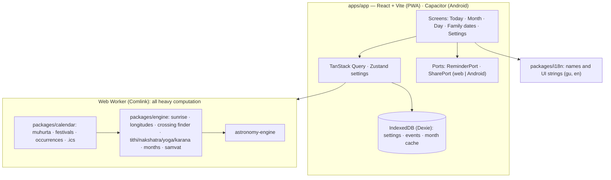

# Parivar Panchang · પરિવાર પંચાંગ

A calm, private, offline Hindu panchang that's Gujarati-first and diaspora-aware, built around **personal tithi reminders**: family birthdays by tithi, varsi/shraddh, and anniversaries that follow the lunar calendar.

**Web:** panchang.bhavyladani.in (goes live at release finalization, after the Phase 11.5 UI revamp) · **Android:** Google Play closed testing · No account, no server, no analytics, no ads.

> Screenshots will be added after the Phase 11.5 UI revamp.

## What it does

- **Today at a glance:** tithi, nakshatra, yoga, karana and weekday with the times they change; current Choghadiya and the next good time; Rahu Kaal, Yamaganda, Gulika and Bhadra on a proportional timeline; sun and moon times.
- **Family dates by tithi:** saved as lunar dates (e.g. Kartak Vad 5), recomputed every year with the family's conventions (printed-calendar day or aparahna for shraddh, vriddhi/kshaya tithis, adhik months, Pitru Paksha), for the family's city even when you live abroad. Enter by tithi or from a Gregorian date with a confirm step.
- **Reminders:** exact Android notifications at your chosen time, never later than that time in the family's city; `.ics` calendar export on the web.
- **Private and offline:** everything is computed on the device; PWA and Android app; JSON backup/restore.
- **Gujarati and English** throughout; large text; light/dark in six themes; WCAG 2.2 AA checked in CI.

Festivals are computed but **hidden in production** until each rule is checked against printed calendars ([festival gate](docs/release/festival-gate.md)).

## Accuracy

Measured in CI against [Drik Panchang](https://www.drikpanchang.com) for Ahmedabad (`pnpm --filter @panchang/engine accuracy`; latest report from CI run 40017241984). Engine − reference; the reference shows whole minutes, so ±30 s of each error is rounding. Tolerances (§4.2): sunrise/sunset ±1 min, element end times ±2 min.

| 82 days, 2026–27 | max \|error\| | mean | n |
|---|---|---|---|
| Sunrise (upper limb + refraction) | 33 s | +2 s | 82 |
| Sunset | 33 s | +2 s | 82 |
| Tithi ends | 97 s | +60 s | 84 |
| Nakshatra ends | 53 s | +18 s | 79 |
| Yoga ends | 58 s | −16 s | 88 |
| Karana ends | 97 s | +60 s | 168 |

Elements present on each civil day: 0 differences. Month, samvat and weekday: 0 mismatches. Engine Lahiri − Drik's displayed ayanamsa: a constant −24.1″ ([ADR 0019](docs/adr/0019-lahiri-ayanamsa-mean.md)). Full per-year tables: the `accuracy-report` CI artifact.

## Architecture



- **Pure core:** `engine` and `calendar` take UTC instants and coordinates; no `Date.now()`, DOM, IndexedDB or time-zone libraries (enforced by lint). Time zones are applied only at the UI edge with `Intl`.
- **Worker boundary:** the main thread never calls the engine; months are computed in a Web Worker and cached in IndexedDB, keyed by engine version, city and month.
- **Parse, don't validate:** dates, months, location ids, URLs and backup files are parsed into branded types at every boundary ([ADR 0014](docs/adr/0014-router-and-parse-dont-validate.md)).
- **Tokens:** colour, type and spacing come from three-layer design tokens with an automated contrast test ([ADR 0017](docs/adr/0017-design-token-architecture.md)).
- **Budgets** (§7): initial JS ≈ 158 KB gzip, worker 32 KB; Today visible < 1 s warm; month < 300 ms, checked in E2E.

Decisions are recorded in [`docs/adr/`](docs/adr/); scope, specs and phases in [`PROJECT_PLAN.md`](PROJECT_PLAN.md).

## Trust

- [How this is calculated](https://panchang.bhavyladani.in/how) · [Privacy policy](https://panchang.bhavyladani.in/privacy)
- "Report a mismatch" in the app opens a pre-filled GitHub issue with the date, city, settings and engine version.

## Development

Node 24, pnpm 11.

```sh
pnpm install
pnpm --filter @panchang/app dev        # dev server (shows unverified festivals, marked)
pnpm typecheck && pnpm lint && pnpm format:check && pnpm test
pnpm --filter @panchang/app e2e        # Playwright E2E + axe + budgets (production build)
pnpm --filter @panchang/engine accuracy
pnpm --filter @panchang/app android:debug   # debug APK
```

Release: [web](docs/release/web.md) · [Android AAB](docs/release/android.md) · [Play listing kit](docs/release/play-store.md).

City data: [GeoNames](https://www.geonames.org), CC-BY 4.0. Astronomy: [astronomy-engine](https://github.com/cosinekitty/astronomy) (MIT). Fonts: Plus Jakarta Sans, Anek Gujarati, Space Grotesk, Fraunces, Noto Serif Gujarati, Marcellus, Hind Vadodara, Baloo Bhai 2, Geist, Noto Sans Devanagari (OFL).

## License

TBD.
