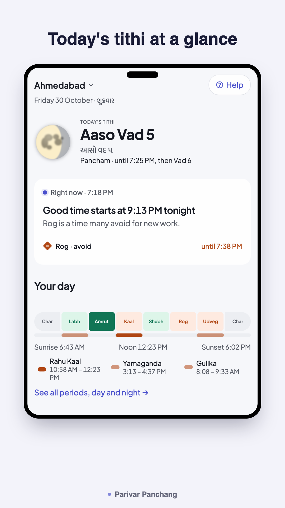
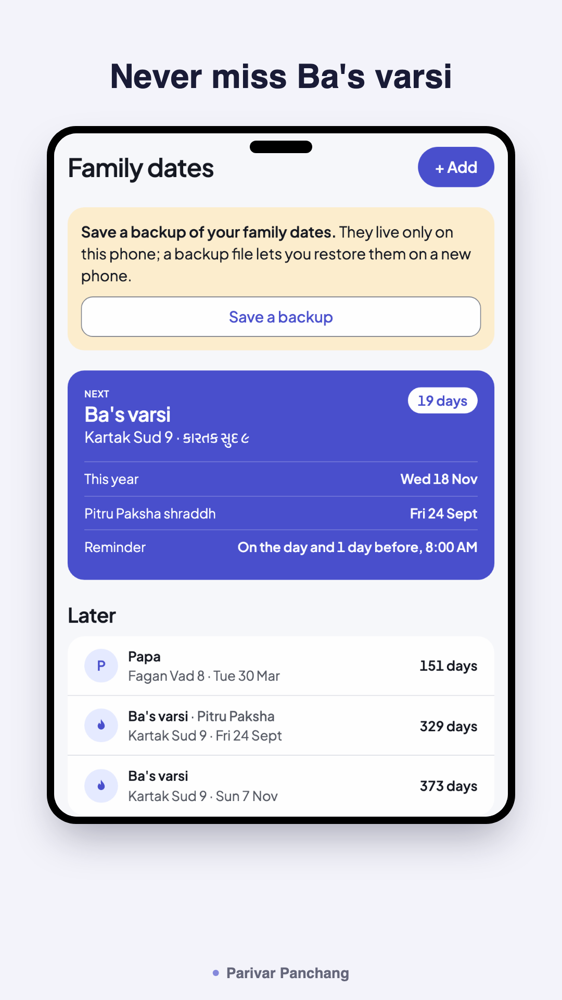
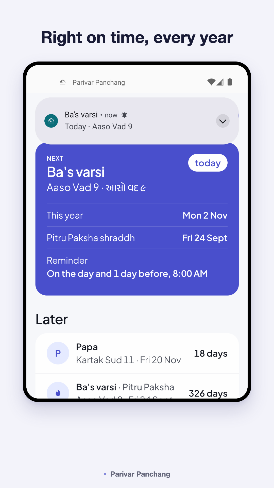
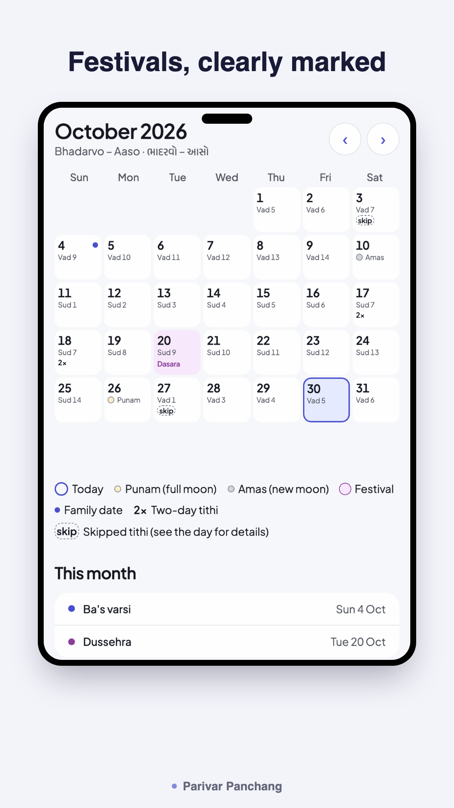

# Parivar Panchang · પરિવાર પંચાંગ

**A calm Gujarati panchang that remembers your family's dates by tithi.**

No account · No ads · No tracking · Works offline

[**Open the app**](https://panchang.bhavyladani.in) · Android app coming soon on Google Play

 

## Why

Ba's varsi, Papa's birthday, your wedding anniversary: many families keep these by tithi, not by the English date. That date moves every year. Parivar Panchang works it out for you and reminds you in time.

## What you get

- **Today at a glance:** tithi, nakshatra, yoga and karana, with the times they change
- **Good times and times to avoid:** Choghadiya hour by hour, Rahu Kaal, Yamaganda, Gulika and Bhadra
- **Family dates:** add a birthday, varsi or anniversary once; it finds the right day every year
- **Reminders** the day before and on the day, at the time you choose
- **Month view** with festivals, shown only once their dates are checked against published panchangs
- **For families abroad:** follow Ahmedabad's date from New Jersey or London
- **Gujarati or English,** large clear text, light and dark themes

## Private by design

Everything stays on your phone. There's no sign-up, and nothing you enter is ever sent to us. Save a backup file whenever you like.

## How accurate is it?

Checked against Drik Panchang: sunrise within a minute, tithi end times within about two minutes. [How it's calculated](https://panchang.bhavyladani.in/how)

## Found a wrong date?

Tap **Report a mismatch** in the app, or [open an issue](https://github.com/bhavy67/pocket-panchang/issues). Correct dates matter more than anything else here.

---

[Privacy policy](https://panchang.bhavyladani.in/privacy) · [For developers](docs/DEVELOPMENT.md)
