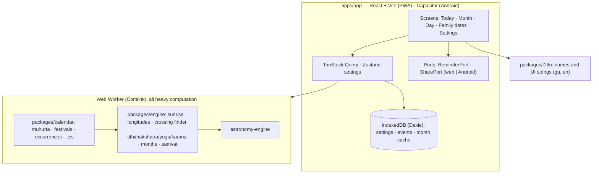

# Development

Technical notes moved out of the README (2026-11-02), which is now written for users.

## Accuracy

Measured in CI against [Drik Panchang](https://www.drikpanchang.com) for Ahmedabad (`pnpm --filter @panchang/engine accuracy`; latest report from CI run 40017241984). Engine − reference; the reference shows whole minutes, so ±30 s of each error is rounding. Tolerances (§4.2): sunrise/sunset ±1 min, element end times ±2 min.

| 82 days, 2026–27                  | max \|error\| | mean  | n   |
| --------------------------------- | ------------- | ----- | --- |
| Sunrise (upper limb + refraction) | 33 s          | +2 s  | 82  |
| Sunset                            | 33 s          | +2 s  | 82  |
| Tithi ends                        | 97 s          | +60 s | 84  |
| Nakshatra ends                    | 53 s          | +18 s | 79  |
| Yoga ends                         | 58 s          | −16 s | 88  |
| Karana ends                       | 97 s          | +60 s | 168 |

Elements present on each civil day: 0 differences. Month, samvat and weekday: 0 mismatches. Engine Lahiri − Drik's displayed ayanamsa: a constant −24.1″ ([ADR 0019](adr/0019-lahiri-ayanamsa-mean.md)). Full per-year tables: the `accuracy-report` CI artifact.

## Architecture



- **Pure core:** `engine` and `calendar` take UTC instants and coordinates; no `Date.now()`, DOM, IndexedDB or time-zone libraries (enforced by lint). Time zones are applied only at the UI edge with `Intl`.
- **Worker boundary:** the main thread never calls the engine; months are computed in a Web Worker and cached in IndexedDB, keyed by engine version, city and month.
- **Parse, don't validate:** dates, months, location ids, URLs and backup files are parsed into branded types at every boundary ([ADR 0014](adr/0014-router-and-parse-dont-validate.md)).
- **Tokens:** colour, type and spacing come from three-layer design tokens with an automated contrast test ([ADR 0017](adr/0017-design-token-architecture.md)).
- **Budgets** (§7): initial JS ≈ 158 KB gzip, worker 32 KB; Today visible < 1 s warm; month < 300 ms, checked in E2E.
- **Festivals** ship per rule and year only once verified ([festival gate](release/festival-gate.md)).

Decisions are recorded in [`adr/`](adr/); scope, specs and phases in [`PROJECT_PLAN.md`](../PROJECT_PLAN.md).

## Commands

Node 24, pnpm 11.

```sh
pnpm install
pnpm --filter @panchang/app dev        # dev server (shows unverified festivals, marked)
pnpm typecheck && pnpm lint && pnpm format:check && pnpm test
pnpm --filter @panchang/app e2e        # Playwright E2E + axe + budgets (production build)
pnpm --filter @panchang/engine accuracy
pnpm --filter @panchang/app android:debug   # debug APK
```

Release: [web](release/web.md) · [Android AAB](release/android.md) · [Play listing kit](release/play-store.md) · [Play upload folder](../release/play-upload/CHECKLIST.md).

## Credits

City data: [GeoNames](https://www.geonames.org), CC-BY 4.0. Astronomy: [astronomy-engine](https://github.com/cosinekitty/astronomy) (MIT). Fonts: Plus Jakarta Sans, Anek Gujarati, Space Grotesk, Fraunces, Noto Serif Gujarati, Marcellus, Hind Vadodara, Baloo Bhai 2, Geist, Noto Sans Devanagari (OFL).
